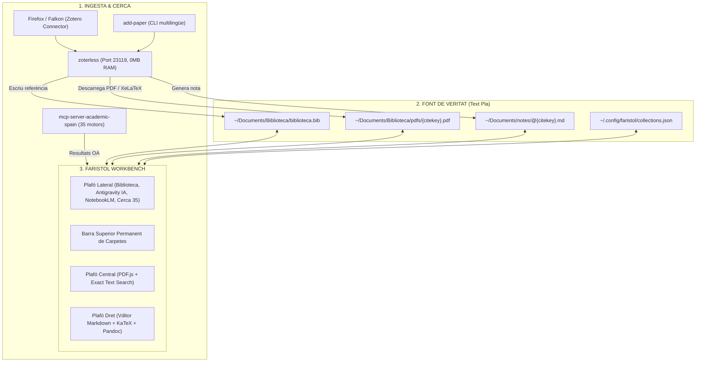

# 📖 Faristol

> **Banc de treball sobirà per a la lectura de PDFs, anotació i síntesi bibliogràfica.**  
> *Inspirat en Org-Noter, Denote, Zotero, Better BibTeX, Better Notes i ZotMoov.*  
> *Zero bases de dades opaques, 100% fitxers plans (Markdown + BibTeX + PDFs).*

---

## 🧭 Què és Faristol?

**Faristol** és una estació de treball acadèmica i entorn de lectura (*reading workbench*) dissenyada per a investigadors, docents i estudiants que volen llegir documents en PDF, prendre notes estructurades i sintetitzar coneixement sense dependre de formats propietaris ni bases de dades tancades (com SQLite o núvols privatius).

El nom prové del mot genuí **faristol** (*el moble o suport inclinat on es col·loca el llibre obert per poder llegir còmodament i prendre notes alhora sense haver d'aguantar-lo amb les mans*): el nostre faristol digital sosté el document PDF davant dels teus ulls mentre prens notes i reflexiones lliurement en el teu quadern de recerca.

Faristol presenta una interfície web moderna de **maquetació en mosaic (tiling) amb zero marges grisos i tres plafons sincronitzats**:

```
┌─────────────────┬───────────────────────────────┬───────────────────────────────┐
│  BARRA SUPERIOR │  📁 Filosofia  📁 Didàctica   📁 IA Educativa  [Totes]        │
├─────────────────┼───────────────────────────────┼───────────────────────────────┤
│ PLAFÓ LATERAL   │       PLAFÓ CENTRAL           │         PLAFÓ DRET            │
│                 │                               │                               │
│ [📚 Biblioteca] │   Visor PDF.js personalitzat  │   Editor Markdown (Vditor)    │
│ [⚡ RAG Local]   │   - Subratllat persistent     │   - Metadades Denote (YAML)   │
│ [🎙️ NotebookLM]│   - Cerca exacta multilínia   │   - Renderitzat KaTeX ($E=mc²)│
│ [🌐 Cerca (35)] │   - Extracció d'anotacions    │   - Cites Pandoc [@citekey]   │
│                 │   - Salts des de la nota      │   - Backlinks i Semàntica ✨  │
│                 │                               │   - Auto-Resum IA & Exportació│
│                 │   ⇄ Intercanvi F7: Editor al centre / PDF a la dreta          │
└─────────────────┴───────────────────────────────┴───────────────────────────────┘
```

1. **Plafó lateral de navegació unificada:**
   - **📚 Biblioteca:** Gestió de col·leccions jeràrquiques, explorador de notes i PDFs unificats 1-a-1, creació ràpida de notes personals (`+ Nota`) i cercador instantani amb cerca full-text i BibTeX.
   - **⚡ RAG Local (Híbrid Docling + BM25 FTS5 + embeddinggemma-2):** Motor 100% local i sobirà de recuperació i síntesi en streaming SSE (< 2 ms en matriu NumPy float32) sobre PDFs, captures HTML i notes Markdown.
   - **🎙️ NotebookLM:** Estudi de recerca i generació d'àudio (RAG) amb exportació directa de respostes a Markdown pur amb cites a pàgina exacta.
   - **🌐 Cerca Acadèmica (35 motors):** Cerca federada en paral·lel mitjançant `mcp-server-academic-spain` i descàrrega en 1 clic amb `add-paper`.
2. **Visor de PDF central (PDF.js personalitzat):** Renderitzat fluid, subratllat persistent, cerca exacta multilínia que creua salts de paràgraf, navegació per pàgines i extracció automàtica de cites textuals (amb obertura neta per defecte sense barra lateral d'esquema).
3. **Editor de notes (Vditor Markdown):** Editor WYSIWYG/Markdown amb suport complet per a KaTeX (fórmules matemàtiques), etiquetes `#tags`, retroenllaços bidireccionals (*backlinks/outlinks*), connexions semàntiques automàtiques (`✨ XX%`), citacions Pandoc `[@citekey, p. X]`, generació de **Resum IA** en 1 clic i **Exportació acadèmica** a Quarto (`.qmd`), PDF (XeLaTeX), HTML i Word (`.docx`).

---

## 💡 Inspiracions i Llinatge

Faristol sintetitza les millors idees del programari lliure acadèmic dels darrers anys en una arquitectura moderna basada en la web i en fitxers plans:

```
┌───────────────────────────────────────────────────────────────────────────┐
│                        INSPIRACIONS DE FARISTOL                           │
├───────────────────────────────────────────────────────────────────────────┤
│ 1. Org-Noter (Emacs)       │ Lectura sincronitzada PDF ↔ Notes a dos plafons│
│ 2. Denote (Emacs)          │ Fitxers plans, identificadors nets i backlinks │
│ 3. Zotero & Connector      │ Captura d'articles al navegador en 1 clic    │
│ 4. Better BibTeX (BBT)     │ Citekeys canòniques 'autorTitolAny' i .bib   │
│ 5. Better Notes            │ Notes Markdown dedicades per a cada referència│
│ 6. ZotMoov / ZotFile       │ Gestió i reanomenat de PDFs en carpetes netes │
└───────────────────────────────────────────────────────────────────────────┘
```

1. **Org-Noter (Emacs):** La lectura sincronitzada entre un document (PDF) i un document de notes, permetent saltar entre el text de la nota i la ubicació exacta del PDF amb un sol clic.
2. **Denote (Emacs - Protesilaos Stavrou):** La filosofia de presa de notes basada estrictament en fitxers de text pla, convencions de nomenclatura senzilles (`@{citekey}.md`), metadades YAML transparents i enllaços/retroenllaços (*backlinks*) directes. Zero bases de dades monolítiques.
3. **Zotero & Zotero Connector:** Ingesta en un sol clic al navegador emulada pel dimoni ultralleuger [zoterless](https://github.com/CasimirVictoria/zoterless) (0 MB RAM en repòs).
4. **Better BibTeX (BBT):** Claus de citació canòniques i predictibles (`autorTitolAny`) i sincronització permanent amb `biblioteca.bib`.
5. **Better Notes:** Cada document té la seua pròpia nota associada en Markdown (`@{citekey}.md`) amb metadades YAML, resum oficial, cites literals i reflexions personals.
6. **ZotMoov / ZotFile:** Els PDFs es desen amb el seu nom canònic `{citekey}.pdf` a la carpeta oberta `~/Documents/Biblioteca/pdfs/`.

---

## 🏛️ L'Ecosistema: Faristol + zoterless + add-paper + academic-spain

Faristol és la interfície de treball visual d'un ecosistema modular basat en la filosofia UNIX (*cada eina fa una cosa i la fa a la perfecció*):



### Divisió de responsabilitats

- **`zoterless`:** El dimoni de captura en segon pla (activat per socket a demanda, 0 MB de RAM en repòs). Rep crides del Zotero Connector, descarrega el PDF en accés obert legal, maqueta articles web a XeLaTeX, actualitza `biblioteca.bib` i crea la nota `@citekey.md`.
- **`add-paper`:** El gestor de línia d'ordres i d'escriptori per incorporar articles per DOI, arXiv, Dialnet o cerca federada interactiva en 35 bases de dades amb traducció local Argos.
- **`Faristol`:** El banc de treball integral on llegeixes el PDF, prens notes al costat, interactues amb la IA d'Antigravity o NotebookLM i organitzes les teues col·leccions temàtiques.

---

## ✨ Característiques Principals

### 1. Maquetació en Mosaic (Tiling) sense Marges Grisos i Panells Plegables
- Aprofita el 100% de la resolució del teu monitor amb panells acoblats i redimensionables.
- **Barra de carpetes superior permanent:** Permet filtrar la biblioteca per col·leccions o temes amb un sol clic sense perdre l'espai de lectura.
- **Mostrar / Amagar Panells (Sense distraccions):** Cadascun dels tres panells (Plafó Lateral de Biblioteca, Visor Central i Editor de Notes) es pot plegar o desplegar a voluntat amb botons discrets de col·lapse (`◀` / `▶`). Pots deixar el visor de PDF a pantalla completa per a lectura immersiva, o l'editor Markdown aïllat per a redacció sense elements visuals que distraguen.

### 2. Intercanvi Dinàmic de Panells (`F7` / `Alt + W`)
- **Mode Lectura (per defecte):** Document (PDF o web) al centre per a una lectura reposada i editor de notes a la dreta per anotar idees.
- **Mode Redacció intensiva:** Prem `F7` o el botó `⇄ Intercanviar` per situar l'editor Markdown al centre en gran format, deixant el PDF a la dreta com a panell lateral de consulta ràpida.
- Canvia de disposició a l'instant amb una sola drecera sense recarregar la pàgina ni perdre la posició de lectura.

### 3. RAG Híbrid Local (Docling + BM25 FTS5 + embeddinggemma-2 en NumPy float32)
Faristol integra un motor de **RAG Local Híbrid d'alta velocitat** a la pestanya lateral **[ ⚡ RAG Local ]**, que permet consultar la totalitat de la biblioteca (documents PDF, captures HTML i notes personals) sense dependre de servidors externs:
- **Indexació amb Docling:** Extracció precisa d'estructures, taules i jerarquia de documents.
- **Cerca Híbrida (Recíproca / RRF):** Combina el motor lèxic **SQLite FTS5 (BM25)** amb embeddings semàntics **`embeddinggemma-2`** calculats en memòria RAM sobre una matriu **NumPy float32** (< 2 ms de latència per consulta).
- **Dos modes de consulta:**
  - **⚡ Evidències:** Recuperació directa i instantània (~50-150 ms) dels fragments més rellevants amb puntuació de confiança, sense passar per cap model generatiu.
  - **🧠 Síntesi IA (Streaming SSE):** Síntesi rigorosa amb streaming token a token (`event: metadata`, `token`, `done`) mitjançant models locals d'Ollama (`gemma4:e2b`, `qwen3.5:4b`, etc.) o models externs.
- **Cites interactives amb salt al PDF o nota:** Totes les respostes inclouen insígnies `[@citekey, p. X]` o `[@nota]`; en fer clic, Faristol salta a la pàgina exacta del PDF o obre la nota associada a l'editor.
- **Accions immediates:** Botons per a *Crear nota nova* amb la síntesi i les cites, *Inserir a la nota activa* al punt del cursor, o *Copiar* el Markdown net al porta-retalls.
- **Autoindexació en segon pla:** En desar o crear una nota, pujar un PDF o capturar un URL, Faristol encoa automàticament la indexació incremental en segon pla sense bloquejar la interfície.
- **Sincronització amb la Paperera:** En moure un document o nota a la Paperera, es purguen automàticament els seus vectors i entrades de `vectors.db`.

### 4. Auto-Resum IA i Exportador Acadèmic Quarto / Pandoc
A la barra d'eines de l'editor de notes:
- **✨ Resum IA (`resumirNotaActualAmbRag`):** Genera automàticament en un clic un resum executiu i 4-6 idees clau fonamentades en el PDF indexat, respectant el frontmatter YAML existent de la nota.
- **📤 Menú d'Exportació (`/api/export/document`):**
  - **Quarto Markdown (`.qmd`):** Exporta la nota neta estructurada per a compilació de llibres o informes científics.
  - **PDF Acadèmic (XeLaTeX + Pandoc):** Compilació directa amb `pandoc --citeproc --pdf-engine=xelatex`, resolent totes les cites de la nota contra el fitxer canònic `biblioteca.bib`.
  - **HTML Autocontingut (`--embed-resources`):** Informe web independent amb estils i recursos incrustats.
  - **Document Word (`.docx`):** Format editable per a tràmits administratius o col·laboracions.

### 5. Xat de Recerca amb Google NotebookLM (RAG al Núvol per Projectes)
Faristol integra directament l'estudi de recerca i generació d'àudio de **Google NotebookLM** mitjançant el client `nlm` a la pestanya lateral **[ 🎙️ NotebookLM ]**:

- **Quaderns temàtics per col·lecció:** Connecta les teues carpetes d'estudi amb els seus quaderns corresponents de NotebookLM (ex: *Creativitat*, *Pensament Computacional*, *Filosofia*).
- **Selecció granular de fonts (*checkboxes*):** Permet activar o desactivar articles concrets (`Fonts (X/Y)`) per limitar la consulta als documents que t'interessen o preguntar transversalment sobre la totalitat del quadern.
- **Botó d'ingesta ràpida («📥 Ingerir PDF»):** A la barra superior del visor central, amb un sol clic pots enviar qualsevol PDF que estigues llegint directament a NotebookLM per afegir-lo com a font d'estudi.
- **Xat en temps real fonamentat en les teues fonts:** Fes preguntes complexes, demana contrastos entre autors, metodologies emprades o síntesis comparatives. Totes les respostes es generen estrictament amb el contingut dels teus documents.
- **Citacions numèriques interactives amb salt al PDF:** Cada afirmació de NotebookLM inclou citacions de font; en fer clic sobre qualsevol cita, **Faristol obre automàticament el PDF corresponent al visor central i salta a la pàgina exacta** ressaltant el text d'evidència.
- **Injecció a la nota i síntesi transversal:** Pots injectar la resposta de la IA directament a la teua nota oberta o exportar la conversa sencera a Markdown pur. Això crea automàticament retroenllaços bidireccionals que apareixen a la secció inferior **«Connexions de la nota»** vinculant la literatura analitzada.

### 6. Cerca Acadèmica Federada en 35 Motors
- Pestanya **[ 🌐 Cerca ]** connectada a `mcp-server-academic-spain`.
- Consulta en paral·lel a repositoris nacionals i internacionals: Dialnet, OpenAlex, CSIC, arXiv, PubMed, ERIC, SciELO, DOAJ, DBLP, Recolecta, TDX, etc.
- **Importació en 1 clic:** descàrrega en accés obert, registre BibTeX i creació de nota instantània mitjançant `add-paper`.

### 7. Visor Dual de Documents: PDFs i Captures Web HTML (Estil Zotero)
Faristol replica i supera la comoditat de lectura de Zotero portant-la al món del text pla i del web obert, servint com a visor universal tant per a documents PDF com per a **captures web completes en format HTML (SingleFile)**:
- **Captura d'Articles Web (SingleFile / Zotero Connector):** Quan arxives una pàgina web mitjançant l'extensió SingleFile o mitjançant el Zotero Connector (emulat pel dimoni `zoterless`), Faristol en guarda una còpia autèntica autònoma (`.html`) juntament amb la seua nota Markdown associada (`@{citekey}.md`).
- **Lectura d'Snapshots HTML autèntics:** Carrega directament la pàgina web arxivada conservant la tipografia, imatges, taules, gràfics interactius i la maquetació original del lloc web, sense trencar l'estil ni dependre de connexió a internet.
- **Subratllat interactiu persistent (com als PDFs de Zotero):** Funciona exactament igual en PDFs que en arxius HTML; selecciona qualsevol text al document web i fes clic al menú flotant **«Subratllar»** (el text queda destacat amb ressaltat persistent i es desa automàticament a `highlights.json`).
- **Extracció de cites directes a la nota:** En seleccionar text en un PDF o en una pàgina web HTML, prem **«Citar»** per a injectar automàticament la cita textual a l'editor Markdown amb la seua referència canònica.
- **Sincronització bidireccional:** En fer clic a una citació o fragment a la nota, Faristol desplaça el document central (*scroll* suau) fins al paràgraf exacte, tant si és una pàgina de PDF com una secció d'una captura web HTML.
- **Cerca multilínia d'alta precisió:** Troba termes i oracions que creuen salts de paràgraf o guionets de tall.

### 8. Editor Markdown Ric (Vditor) amb Connexions Semàntiques
- Format en temps real, mode pantalla dividida o mode codi font pur.
- Renderitzat matemàtic complet amb KaTeX (`$E = mc^2$`).
- Metadades Denote YAML netes (`title`, `authors`, `year`, `citekey`, `tags`).
- **Calaix de Connexions:** Mostra enllaços sortints, mencions entrants (*backlinks*) i **Connexions Semàntiques automàtiques (`✨ XX%`)** calculades en temps real per similitud de cosinus sobre la matriu vectorial.
- **Creació de Notes Pròpies (sense `@`):** Botó `+ Nota` a la biblioteca i barra superior per a crear notes personals Denote cronològiques amb plantilles (*Lliure en blanc*, *Concepte atòmic*, *Estat de l'art*, *Diari*) i etiquetatge flexible.
- **Cerca Full-Text i BibTeX en RAM:** Memòria cau `_NOTES_CACHE` amb invalidació per `mtime`/`size` que respon a cerques en mil·lisegons sense bloquejar el disc.

### 9. Actius 100% Locals i Arquitectura Modular (Zero CDNs)
- Tots els recursos web (`FontAwesome 6.5.1` amb les seues 8 fonts locals, `marked.min.js`, `Vditor`, `PDF.js`, `Plotly`, `KaTeX`) s'allotgen a `faristol/static/libs/`, garantint funcionament fluid fins i tot en xarxes aïllades o sense connexió.
- Codi frontend estructurat modularment a `static/css/faristol.css`, `static/js/app.js` i `static/js/rag_and_export.js`.

### 10. Ubiquitat Mòbil, Adaptació Automàtica de la Interfície i Accés Remot (Tailscale)
- **Adaptació Automàtica al Mòbil / Tauleta (`< 900px`):**
  - Quan s'accedeix des d'un telèfon o pantalla tàctil estreta, Faristol transforma automàticament la maquetació en mosaic en una **experiència monoparafó nativa**: només es mostra un dels tres panells alhora per aprofitar al màxim l'espai de pantalla.
  - **Barra inferior de navegació fixa:** Permet alternar amb el polze entre **[ 📚 Biblioteca ]**, **[ 📖 Lectura ]** (visor PDF/web) i **[ 📝 Nota ]** (editor Markdown).
  - **Navegació intel·ligent per acció:** En prémer qualsevol PDF o pàgina web de la biblioteca, la interfície salta automàticament a la pestanya *Lectura*; en obrir o crear una nota pròpia (`+ Nota`), salta directament a l'editor de *Nota*.
- **Accés des de qualsevol lloc:** Gràcies a la xarxa privada xifrada de **Tailscale**, pots accedir a Faristol (`http://<IP-Tailscale>:8080`) des del telèfon mòbil, tauleta o portàtil estigues on estigues (amb dades 4G/5G, a la universitat o fora de casa), sense exposar cap port a Internet pública.
- **Captura d'Articles Web amb SingleFile des d'Android:**
  - Configurant l'extensió **SingleFile** a Firefox Android (Destinació ➔ *Upload to a REST Form API* ➔ `http://<IP-Tailscale>:23119/singlefile`), en prémer la icona de SingleFile al telèfon es capturen automàticament **dues versions alhora**:
    1. L'**arxiu HTML autèntic** (`{citekey}.html`), llest per ser visualitzat, subratllat i citat a Faristol amb el seu disseny original.
    2. La **versió PDF XeLaTeX** (`{citekey}.pdf`), optimitzada per a impressió o lectors de tinta electrònica.
    3. La **fitxa Markdown** (`@{citekey}.md`), sincronitzada amb les metadades i el text net de l'article.
- **Flux complet de recerca mòbil:**
  1. **Captura en 1 clic des del mòbil:** Quan trobes un article, llibre o PDF al telèfon, l'envies a la biblioteca mitjançant el menú natiu *«Compartir»* d'Android (gràcies a la integració PWA Web Share Target de `zoterless` a `:23119`) o amb SingleFile.
  2. **Lectura immediata a Faristol:** En obrir Faristol al mòbil o a l'ordinador, el document (PDF o HTML) ja apareix a la biblioteca, llest per llegir, anotar i subratllar.
  3. **Copilot IA autònom (Hermit / PWA):** Al mòbil, la IA funciona com a Lite App autònoma a pantalla completa amb Hermit (connectada a `agy-bridge` a `:8000`), permetent una multitasca fluida mitjançant gestos entre la lectura a Faristol i les consultes a l'assistent.

---

## 📁 Estructura de Fitxers Canònica

Faristol opera exclusivament sobre la teua estructura estàndard de fitxers plans:

```text
~/Documents/
├── Biblioteca/
│   ├── biblioteca.bib          # Base de dades BibTeX canònica
│   └── pdfs/                   # PDFs organitzats per citekey
│       ├── berzosaPensamentComputacional2024.pdf
│       └── turingComputingMachinery1950.pdf
└── notes/                      # Notes en Markdown / Denote
    ├── @berzosaPensamentComputacional2024.md
    ├── @turingComputingMachinery1950.md
    └── 20260920T120000--didactica-de-la-fisica_ciencies.md
```

Configuració i metadades auxiliars:

```text
~/.config/faristol/
├── collections.json            # Arbre de col·leccions virtuals
└── highlights.json             # Subratllats de lectura persistents
```

### 🧩 Arquitectura del codi font

L'API (FastAPI) està modularitzada en un paquet `faristol/api/`, amb un subrouter per domini que es munten davall del prefix `/api`:

```text
faristol/
├── server.py            # Aplicació FastAPI, seguretat (Host/CSRF/capçaleres) i fitxers estàtics
├── api/
│   ├── __init__.py      # Router principal (/api) que agrega els subrouters
│   ├── common.py        # Logger i validació estricta de rutes (_ruta_segura_nota, _document_segur)
│   ├── models.py        # Models Pydantic de les peticions
│   ├── notes.py         # Notes (Denote/sense @), paperera, connexions i cerca full-text
│   ├── pdf.py           # Streaming de PDF i subratllats
│   ├── rag.py           # RAG Híbrid Local (Docling + BM25 + embeddinggemma-2 + SSE stream)
│   ├── export.py        # Exportador Quarto (.qmd), PDF (XeLaTeX), HTML i Word
│   ├── library.py       # Biblioteca, fonts, esdeveniments SSE i BibTeX
│   ├── search.py        # Cerca acadèmica federada, Zotero-less i MCP local
│   ├── workbench.py     # Accions del banc de treball (integració externa)
│   ├── collections.py   # Col·leccions virtuals
│   └── nlm.py           # NotebookLM (RAG)
├── config.py  utils.py  bibtex.py  fsatomic.py
└── static/              # Interfície web 100% offline (HTML, CSS modular, JS, Vditor, PDF.js, KaTeX)
    ├── css/faristol.css
    ├── js/app.js
    └── js/rag_and_export.js
```

### 🏷️ La Convenció de l'Arroba (`@`): Notes Bibliogràfiques vs. Notes Pròpies

| Tipus de Nota | Nomenclatura del fitxer | Descripció i Propòsit | Exemple |
| :--- | :--- | :--- | :--- |
| **Nota Bibliogràfica** *(Literature Note)* | **`@{citekey}.md`** *(amb arroba inicial)* | Fitxa vinculada directament a una font externa. Conté les metadades YAML (`citekey`, `pdf`), resums, cites textuals i reflexions sobre la lectura. | `@berzosaPensamentComputacional2024.md` |
| **Nota Pròpia / Permanent** *(Evergreen / Atomic Note)* | **`{timestamp}--{slug}_{tags}.md`** o **`{slug}.md`** *(sense arroba)* | Nota de pensament propi elaborada per nosaltres. Desenvolupa un argument personal (seguint Denote/Zettelkasten). Enllaça a fonts amb `[[@citekey]]` o `[@citekey, p. 12]`. | `20260920T120000--didactica-de-la-fisica_ciencies.md` |

---

## ⌨️ Dreceres de Teclat a Faristol

| Drecera | Acció |
| :--- | :--- |
| `F7` o `Alt + W` | **Intercanvia els panells:** col·loca l'Editor al centre o torna el PDF al centre |
| `Alt + T` | **Alterna el tema:** Clar (per defecte) / Fosc (amb sincronització a panells IA) |
| `Alt + 1` | Activa el Plafó Lateral |
| `Alt + 2` | Activa el Visor de PDF |
| `Alt + 3` | Activa l'Editor de Notes |
| `Ctrl + S` | Desa immediatament la nota activa |
| `Ctrl + F` | Cerca al document o a la llista de notes |
| `Ctrl + Enter` | Executa la cerca acadèmica o envia consulta a NotebookLM |

---

## 🚀 Instal·lació i Ús

### Requisits

- Python 3.10 o superior.
- Navegador web modern (Firefox, Chromium, Brave).
- Opcional: `okular` (visor natiu KDE), `kate` (editor natiu KDE), `nlm` (NotebookLM CLI).
  - Faristol localitza `nlm` automàticament al `PATH` i, si no hi és, a `~/.local/bin/nlm`. Si el tens en un altre lloc, indica'l amb la variable d'entorn **`FARISTOL_NLM_BIN`** a `~/.config/faristol/faristol.env` (vegeu [`systemd/faristol.env.example`](systemd/faristol.env.example)).

### Instal·lació automàtica (amb servei Systemd)

```bash
# 1. Clonar el repositori
git clone https://github.com/CasimirVictoria/faristol.git ~/Projects/faristol
cd ~/Projects/faristol

# 2. Instal·lar dependències
pip install -r requirements.txt

# 3. Executar l'instal·lador (enllaça l'executable i activa el servei systemd)
chmod +x install.sh
./install.sh
```

---

## ⚙️ Servei de Fons Systemd (Arrencada Automàtica)

Faristol inclou una unitat de servei d'usuari a [`systemd/faristol.service`](systemd/faristol.service) per funcionar de forma permanent en segon pla:
- **Arrencada silenciosa i persistent:** S'inicia automàticament a cada inici de sessió de Linux.
- **Accés universal:** El servei escolta a `0.0.0.0:8080` (totes les interfícies de xarxa), de manera que és accessible immediatament:
  - **En local:** `http://localhost:8080` o `http://127.0.0.1:8080`.
  - **A la xarxa local (LAN):** `http://<nom-equip>:8080` o `http://<IP-LAN>:8080`.
  - **Via Tailscale:** `http://<IP-Tailscale>:8080` o `http://<nom-equip>.<tailnet>.ts.net:8080`, des del mòbil o tauleta.
- **Reinici automàtic:** Si el procés s'atura per qualsevol motiu, systemd el reinicia automàticament en 3 segons.

> ⚠️ **Nota de seguretat i llista blanca d'amfitrions:** En escoltar a `0.0.0.0`, Faristol queda accessible des de qualsevol equip de la teua xarxa local. Per això valida cada petició amb una **llista blanca d'amfitrions**, configurable amb la variable d'entorn **`FARISTOL_ALLOWED_HOSTS`** (valors separats per comes; s'admet el comodí `*.domini`). Si no es defineix, només s'accepten les adreces locals (`127.0.0.1`, `localhost`). Si hi accedeixes per una adreça que no hi consta, rebràs un error *«Invalid host header»*.

La configuració local (llista blanca, ruta de `nlm`, directoris MCP...) viu **fora del repositori**, a `~/.config/faristol/faristol.env` (el servei el llig via `EnvironmentFile=`; vegeu la plantilla [`systemd/faristol.env.example`](systemd/faristol.env.example)). L'instal·lador el crea automàticament si no existeix. Per a accedir-hi des de **Tailscale** i la **xarxa local**, ajusta-n'hi la llista:

```ini
# ~/.config/faristol/faristol.env
FARISTOL_ALLOWED_HOSTS=127.0.0.1,localhost,<nom-equip>,<IP-LAN>,<IP-Tailscale>,*.ts.net
```

Després de canviar la llista, recarrega systemd i reinicia el servei:

```bash
systemctl --user daemon-reload
systemctl --user restart faristol.service
```

> **No obris mai este port directament a Internet**; per a l'accés remot fora de casa fes servir sempre **Tailscale**.

### Gestió del servei

```bash
# Activar i arrencar el servei immediatament
systemctl --user enable --now faristol.service

# Comprovar l'estat del servei
systemctl --user status faristol.service

# Veure el registre d'activitat (logs) en temps real
journalctl --user -u faristol -f

# Reiniciar o aturar el servei
systemctl --user restart faristol.service
systemctl --user stop faristol.service
```

---

## 🔐 Autenticació i Sessió (Recorda'm)

Faristol pot protegir-se amb **autenticació per sessió** basada en cookie `HttpOnly`, pensada per a l'ús còmode des del mòbil (recorda el dispositiu fins a **30 dies**).

Per a activar-la, definix usuari i contrasenya a `~/.config/faristol/faristol.env`:

```ini
FARISTOL_AUTH_USER=el_teu_usuari
FARISTOL_AUTH_PASSWORD=la_teua_contrasenya
# Opcional: secret de signatura (si no, se'n genera un i es guarda a session_secret)
# FARISTOL_SESSION_SECRET=...
# FARISTOL_SESSION_DAYS=30
# FARISTOL_COOKIE_SECURE=1   # només si servixes per HTTPS
```

```bash
systemctl --user restart faristol.service
```

Com funciona:
- Sense sessió, l'API respon **`401`** i les pàgines HTML redirigeixen a **`/login`**.
- En iniciar sessió, s'establix una cookie `faristol_session` **`HttpOnly`** + `SameSite=Lax`, signada (HMAC-SHA256) amb caducitat de 30 dies (el clàssic «Recorda'm»).
- El botó **⏻ (Tancar sessió)** de la barra superior esborra la sessió; si la sessió caduca amb l'app oberta, es torna automàticament a `/login`.
- El propi `/login` i els **arxius estàtics** no requerixen sessió.

> 🔒 Si **no** definixes `FARISTOL_AUTH_USER` i `FARISTOL_AUTH_PASSWORD`, l'autenticació queda **desactivada** i tot és accessible (comportament retrocompatible). Combina-la sempre amb la llista blanca d'amfitrions i, per a accés remot, amb Tailscale.

---

## 💻 Execució Manual per Consola

Si prefereixes executar Faristol de forma interactiva sense el servei systemd:

```bash
# Iniciar Faristol i obrir el navegador automàticament (port 8080)
faristol

# Obrir un PDF directament a Faristol
faristol paper.pdf
faristol ~/Documents/Biblioteca/pdfs/berzosaPensamentComputacional2024.pdf

# Obrir una nota directament a Faristol
faristol @berzosaPensamentComputacional2024.md

# Especificar un port alternatiu o mode sense obrir navegador
faristol --port 8090
faristol --no-browser
```

> ℹ️ **Amfitrió d'escolta (host):** El servei systemd de més amunt escolta a `0.0.0.0` (accessible a la LAN i a Tailscale). En canvi, l'execució manual `faristol` escolta per defecte a `127.0.0.1` (només local). Si vols exposar una execució manual a la xarxa local o a Tailscale, indica-ho explícitament amb `--host`:

```bash
# Exposar una execució manual a totes les interfícies (LAN + Tailscale)
faristol --host 0.0.0.0

# Canviar de port i no obrir el navegador
faristol --host 0.0.0.0 --port 8090 --no-browser
```

---

## 🧪 Tests

Faristol inclou una suite de proves (`pytest`) que aïlla totes les dades en un directori temporal i **no toca la teua biblioteca real**:

```bash
# Instal·lar les dependències de desenvolupament
pip install -e ".[dev]"

# Executar la suite
pytest
```

Cobreix la superfície de rutes de l'API, les defenses de seguretat (capçaleres, llista blanca d'amfitrions i CSRF), la validació estricta de rutes (anti *path traversal*) i els cicles de vida de notes i subratllats.

---

## ⚠️ Avís de Responsabilitat i Projecte Personal

Aquest és un **projecte personal de recerca i desenvolupament**, concebut per donar resposta a les necessitats particulars d'estudi de l'autor:
- **Sense garanties (*AS-IS*):** Es distribueix sota la llicència MIT de forma gratuïta i comunitària, «tal com és», sense cap garantia explícita ni implícita.
- **Exempció de responsabilitat:** L'autor no es fa responsable de cap pèrdua d'informació, corrupció de fitxers o fallades del sistema. **Recomanem fermament als usuaris mantindre còpies de seguretat periòdiques (amb Git, Borg, Restic o similars) de les seues notes, PDFs i bases de dades.**
- **Respecte als drets d'autor:** L'usuari és l'únic responsable dels documents que descarrega, emmagatzema, visualitza o indexa a la seua biblioteca local.

---

## 🤖 Autoria i Desenvolupament amb Antigravity CLI

- **Concepció, visió del flux i arquitectura d'usuari:** Casimir Victoria (@CasimirVictoria).
- **Desenvolupament i implementació tècnica del codi:** Desenvolupat, programat i afinat íntegrament en programació en parella (*pair programming*) emprant l'agent d'intel·ligència artificial **Antigravity CLI** (`agy`) de Google DeepMind.

> *"Faristol neix de la passió pel text pla, la lectura atenta i la sobirania digital en la investigació acadèmica. Casimir n'ha marcat les necessitats, la visió i el disseny d'interacció; la programació i la construcció tècnica han estat dutes a terme amb Antigravity CLI."*

---

## 📄 Llicència

Distribuït sota la llicència [MIT](LICENSE). Desenvolupat amb passió pel programari lliure, el text pla i la sobirania digital.
