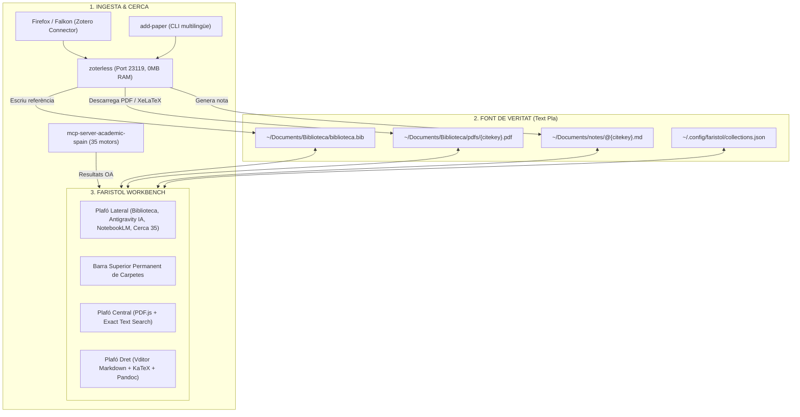

# 📖 Faristol

> **Banc de treball sobirà per a la lectura de PDFs, anotació i síntesi bibliogràfica.**  
> *Inspirat en Org-Noter, Denote, Zotero, Better BibTeX, Better Notes i ZotMoov.*  
> *Zero bases de dades opaques, 100% fitxers plans (Markdown + BibTeX + PDFs).*

---

## 🧭 Què és Faristol?

**Faristol** és una estació de treball acadèmica i entorn de lectura (*reading workbench*) dissenyada per a investigadors, docents i estudiants que volen llegir documents en PDF, prendre notes estructurades i sintetitzar coneixement sense dependre de formats propietaris ni bases de dades tancades (com SQLite o núvols privatius).

El nom prové del mot genuí **faristol** (*el moble o suport inclinat on es col·loca el llibre obert per poder llegir còmodament i prendre notes alhora sense haver d'aguantar-lo amb les mans*): el nostre faristol digital sosté el document PDF davant dels teus ulls mentre prens notes i reflexiones lliurement en el teu quadern de recerca.

Faristol presenta una interfície web moderna de **maquetació en mosaic (tiling) amb zero marges grisos i tres plafons sincronitzats**:

```
┌─────────────────┬───────────────────────────────┬───────────────────────────────┐
│  BARRA SUPERIOR │  📁 Filosofia  📁 Didàctica   📁 IA Educativa  [Totes]        │
├─────────────────┼───────────────────────────────┼───────────────────────────────┤
│ PLAFÓ LATERAL   │       PLAFÓ CENTRAL           │         PLAFÓ DRET            │
│                 │                               │                               │
│ [📚 Biblioteca] │   Visor PDF.js personalitzat  │   Editor Markdown (Vditor)    │
│ [🤖 IA (agy)]   │   - Subratllat persistent     │   - Metadades Denote (YAML)   │
│ [🎙️ NotebookLM]│   - Cerca exacta multilínia   │   - Renderitzat KaTeX ($E=mc²)│
│ [🌐 Cerca (35)] │   - Extracció d'anotacions    │   - Cites Pandoc [@citekey]   │
│                 │   - Salts des de la nota      │   - Backlinks i xarxa         │
│                 │                               │                               │
│                 │   ⇄ Intercanvi F7: Editor al centre / PDF a la dreta          │
└─────────────────┴───────────────────────────────┴───────────────────────────────┘
```

1. **Plafó lateral de navegació unificada:**
   - **📚 Biblioteca:** Gestió de col·leccions jeràrquiques, explorador de notes i PDFs unificats 1-a-1, cercador instantani.
   - **🤖 IA (Antigravity agy-bridge):** Copilot d'enginyeria i investigació en viu incrustat (port 8000), sincronitzat en tema clar/fosc, amb KaTeX LaTeX, execució de codi i visor de terminal.
   - **🎙️ NotebookLM:** Estudi de recerca i generació d'àudio (RAG) amb exportació directa de respostes a Markdown pur amb cites a pàgina exacta.
   - **🌐 Cerca Acadèmica (35 motors):** Cerca federada en paral·lel mitjançant `mcp-server-academic-spain` i descàrrega en 1 clic amb `add-paper`.
2. **Visor de PDF central (PDF.js personalitzat):** Renderitzat fluid, subratllat persistent, cerca exacta multilínia que creua salts de paràgraf, navegació per pàgines i extracció automàtica de cites textuals.
3. **Editor de notes (Vditor Markdown):** Editor WYSIWYG/Markdown amb suport complet per a KaTeX (fórmules matemàtiques), etiquetes `#tags`, retroenllaços bidireccionals (*backlinks/outlinks*), citacions Pandoc `[@citekey, p. X]` i salts instantanis a la pàgina exacta del PDF.

---

## 💡 Inspiracions i Llinatge

Faristol sintetitza les millors idees del programari lliure acadèmic dels darrers anys en una arquitectura moderna basada en la web i en fitxers plans:

```
┌───────────────────────────────────────────────────────────────────────────┐
│                        INSPIRACIONS DE FARISTOL                           │
├───────────────────────────────────────────────────────────────────────────┤
│ 1. Org-Noter (Emacs)       │ Lectura sincronitzada PDF ↔ Notes a dos plafons│
│ 2. Denote (Emacs)          │ Fitxers plans, identificadors nets i backlinks │
│ 3. Zotero & Connector      │ Captura d'articles al navegador en 1 clic    │
│ 4. Better BibTeX (BBT)     │ Citekeys canòniques 'autorTitolAny' i .bib   │
│ 5. Better Notes            │ Notes Markdown dedicades per a cada referència│
│ 6. ZotMoov / ZotFile       │ Gestió i reanomenat de PDFs en carpetes netes │
└───────────────────────────────────────────────────────────────────────────┘
```

1. **Org-Noter (Emacs):** La lectura sincronitzada entre un document (PDF) i un document de notes, permetent saltar entre el text de la nota i la ubicació exacta del PDF amb un sol clic.
2. **Denote (Emacs - Protesilaos Stavrou):** La filosofia de presa de notes basada estrictament en fitxers de text pla, convencions de nomenclatura senzilles (`@{citekey}.md`), metadades YAML transparents i enllaços/retroenllaços (*backlinks*) directes. Zero bases de dades monolítiques.
3. **Zotero & Zotero Connector:** Ingesta en un sol clic al navegador emulada pel dimoni ultralleuger [zoterless](https://github.com/CasimirVictoria/zoterless) (0 MB RAM en repòs).
4. **Better BibTeX (BBT):** Claus de citació canòniques i predictibles (`autorTitolAny`) i sincronització permanent amb `biblioteca.bib`.
5. **Better Notes:** Cada document té la seua pròpia nota associada en Markdown (`@{citekey}.md`) amb metadades YAML, resum oficial, cites literals i reflexions personals.
6. **ZotMoov / ZotFile:** Els PDFs es desen amb el seu nom canònic `{citekey}.pdf` a la carpeta oberta `~/Documents/Biblioteca/pdfs/`.

---

## 🏛️ L'Ecosistema: Faristol + zoterless + add-paper + academic-spain

Faristol és la interfície de treball visual d'un ecosistema modular basat en la filosofia UNIX (*cada eina fa una cosa i la fa a la perfecció*):



### Divisió de responsabilitats

- **`zoterless`:** El dimoni de captura en segon pla (activat per socket a demanda, 0 MB de RAM en repòs). Rep crides del Zotero Connector, descarrega el PDF en accés obert legal, maqueta articles web a XeLaTeX, actualitza `biblioteca.bib` i crea la nota `@citekey.md`.
- **`add-paper`:** El gestor de línia d'ordres i d'escriptori per incorporar articles per DOI, arXiv, Dialnet o cerca federada interactiva en 35 bases de dades amb traducció local Argos.
- **`Faristol`:** El banc de treball integral on llegeixes el PDF, prens notes al costat, interactues amb la IA d'Antigravity o NotebookLM i organitzes les teues col·leccions temàtiques.

---

## ✨ Característiques Principals

### 1. Maquetació en Mosaic (Tiling) sense Marges Grisos
- Aprofita el 100% de la resolució del teu monitor amb panells acoblats i redimensionables.
- **Barra de carpetes superior permanent:** Permet filtrar la biblioteca per col·leccions o temes amb un sol clic sense perdre l'espai de lectura.

### 2. Intercanvi Dinàmic de Panells (`F7` / `Alt + W`)
- **Mode Lectura (per defecte):** PDF al centre per a una lectura reposada i editor de notes a la dreta per anotar idees.
- **Mode Redacció intensiva:** Prem `F7` o el botó `⇄` per situar l'editor Markdown al centre en gran format, deixant el PDF a la dreta com a panell lateral de consulta.

### 3. Panell d'Intel·ligència Artificial Integrat (Antigravity `agy-bridge`)
- Accés immediat al teu agent d'IA sobirà des de la pestanya **[ 🤖 IA ]**.
- Integració directa amb `agy-bridge` (port 8000).
- Suport per a consultes de programació, resolució de càlculs, anàlisi de dades, execució de terminals remotes i renderitzat KaTeX LaTeX.
- **Sincronització de Tema Clar / Fosc:** El canvi de tema a Faristol (`Alt + T`) es propaga automàticament a la interfície de la IA.

### 4. Xat de Recerca amb Google NotebookLM (RAG sobre Documents)
Faristol integra directament l'estudi de recerca i generació d'àudio de **Google NotebookLM** mitjançant el client `nlm` a la pestanya lateral **[ 🎙️ NotebookLM ]**:

- **Quaderns temàtics per col·lecció:** Connecta les teues carpetes d'estudi amb els seus quaderns corresponents de NotebookLM (ex: *Creativitat*, *Pensament Computacional*, *Filosofia*).
- **Selecció granular de fonts (*checkboxes*):** Permet activar o desactivar articles concrets (`Fonts (X/Y)`) per limitar la consulta als documents que t'interessen o preguntar transversalment sobre la totalitat del quadern.
- **Botó d'ingesta ràpida («📥 Ingerir PDF»):** A la barra superior del visor central, amb un sol clic pots enviar qualsevol PDF que estigues llegint directament a NotebookLM per afegir-lo com a font d'estudi.
- **Xat en temps real fonamentat en les teues fonts:** Fes preguntes complexes, demana contrastos entre autors, metodologies emprades o síntesis comparatives. Totes les respostes es generen estrictament amb el contingut dels teus documents.
- **Citacions numèriques interactives amb salt al PDF:** Cada afirmació de NotebookLM inclou citacions de font; en fer clic sobre qualsevol cita, **Faristol obre automàticament el PDF corresponent al visor central i salta a la pàgina exacta** ressaltant el text d'evidència.
- **Injecció a la nota i síntesi transversal:** Pots injectar la resposta de la IA directament a la teua nota oberta o exportar la conversa sencera a Markdown pur. Això crea automàticament retroenllaços bidireccionals que apareixen a la secció inferior **«Connexions de la nota»** vinculant la literatura analitzada.

### 5. Cerca Acadèmica Federada en 35 Motors
- Pestanya **[ 🌐 Cerca ]** connectada a `mcp-server-academic-spain`.
- Consulta en paral·lel a repositoris nacionals i internacionals: Dialnet, OpenAlex, CSIC, arXiv, PubMed, ERIC, SciELO, DOAJ, DBLP, Recolecta, TDX, etc.
- **Importació en 1 clic:** descàrrega en accés obert, registre BibTeX i creació de nota instantània mitjançant `add-paper`.

### 6. Visor Dual de Documents: PDFs i Snapshots HTML Autèntics
Faristol no es limita als documents PDF: és un visor universal tant per a documents PDF com per a **captures web completes en format HTML (SingleFile)**:
- **Lectura d'Snapshots HTML autèntics:** Carrega directament pàgines web arxivades conservant la tipografia, imatges, gràfics interactius i maquetació original del web.
- **Subratllat interactiu persistent:** Funciona exactament igual en PDFs que en HTML; selecciona qualsevol text al document HTML i fes clic a **«Subratllar»** (el text queda destacat amb `mark.faristol-highlight` i es manté guardat).
- **Extracció de cites directes:** En seleccionar text en un PDF o en un Snapshot HTML, el menú flotant permet prémer **«Citar»** per injectar automàticament la cita textual a l'editor de notes Markdown de la dreta.
- **Sincronització bidireccional:** En fer clic a una citació o fragment de text a la nota, Faristol realitza un desplaçament (*scroll*) suau i automàtic al panell central fins al paràgraf exacte, tant si és un PDF com un arxiu HTML.
- **Cerca multilínia d'alta precisió:** Troba termes i oracions que creuen salts de paràgraf o guionets de tall.

### 7. Editor Markdown Ric (Vditor)
- Format en temps real, mode pantalla dividida o mode codi font pur.
- Renderitzat matemàtic complet amb KaTeX (`$E = mc^2$`).
- Metadades Denote YAML netes (`title`, `authors`, `year`, `citekey`, `tags`).
- Gràfic de retroenllaços (*backlinks*) per a navegació tipus Zettelkasten.

### 8. Ubiquitat Mòbil i Accés Remot (via Tailscale)
- **Accés des de qualsevol lloc:** Gràcies a la xarxa privada xifrada de **Tailscale**, pots accedir a Faristol (`http://<IP-Tailscale>:8080`) des del telèfon mòbil, tauleta o portàtil estigues on estigues (amb dades 4G/5G, a la universitat o fora de casa), sense exposar cap port a Internet pública.
- **Captura d'Articles Web amb SingleFile des d'Android:**
  - Configurant l'extensió **SingleFile** a Firefox Android (Destinació ➔ *Upload to a REST Form API* ➔ `http://<IP-Tailscale>:23119/singlefile`), en prémer la icona de SingleFile al telèfon es capturen automàticament **dues versions alhora**:
    1. L'**arxiu HTML autèntic** (`{citekey}.html`), llest per ser visualitzat, subratllat i citat a Faristol amb el seu disseny original.
    2. La **versió PDF XeLaTeX** (`{citekey}.pdf`), optimitzada per a impressió o lectors de tinta electrònica.
    3. La **fitxa Markdown** (`@{citekey}.md`), sincronitzada amb les metadades i el text net de l'article.
- **Flux complet de recerca mòbil:**
  1. **Captura en 1 clic des del mòbil:** Quan trobes un article, llibre o PDF al telèfon, l'envies a la biblioteca mitjançant el menú natiu *«Compartir»* d'Android (gràcies a la integració PWA Web Share Target de `zoterless` a `:23119`) o amb SingleFile.
  2. **Lectura immediata a Faristol:** En obrir Faristol al mòbil o a l'ordinador, el document (PDF o HTML) ja apareix a la biblioteca, llest per llegir, anotar i subratllar.
  3. **Copilot IA autònom (Hermit / PWA):** Al mòbil, la IA funciona com a Lite App autònoma a pantalla completa amb Hermit (connectada a `agy-bridge` a `:8000`), permetent una multitasca fluida mitjançant gestos entre la lectura a Faristol i les consultes a l'assistent.

---

## 📁 Estructura de Fitxers Canònica

Faristol opera exclusivament sobre la teua estructura estàndard de fitxers plans:

```text
~/Documents/
├── Biblioteca/
│   ├── biblioteca.bib          # Base de dades BibTeX canònica
│   └── pdfs/                   # PDFs organitzats per citekey
│       ├── berzosaPensamentComputacional2024.pdf
│       └── turingComputingMachinery1950.pdf
└── notes/                      # Notes en Markdown / Denote
    ├── @berzosaPensamentComputacional2024.md
    ├── @turingComputingMachinery1950.md
    └── 20260920T120000--didactica-de-la-fisica_ciencies.md
```

Configuració i metadades auxiliars:

```text
~/.config/faristol/
├── collections.json            # Arbre de col·leccions virtuals
└── highlights.json             # Subratllats de lectura persistents
```

### 🏷️ La Convenció de l'Arroba (`@`): Notes Bibliogràfiques vs. Notes Pròpies

| Tipus de Nota | Nomenclatura del fitxer | Descripció i Propòsit | Exemple |
| :--- | :--- | :--- | :--- |
| **Nota Bibliogràfica** *(Literature Note)* | **`@{citekey}.md`** *(amb arroba inicial)* | Fitxa vinculada directament a una font externa. Conté les metadades YAML (`citekey`, `pdf`), resums, cites textuals i reflexions sobre la lectura. | `@berzosaPensamentComputacional2024.md` |
| **Nota Pròpia / Permanent** *(Evergreen / Atomic Note)* | **`{timestamp}--{slug}_{tags}.md`** o **`{slug}.md`** *(sense arroba)* | Nota de pensament propi elaborada per nosaltres. Desenvolupa un argument personal (seguint Denote/Zettelkasten). Enllaça a fonts amb `[[@citekey]]` o `[@citekey, p. 12]`. | `20260920T120000--didactica-de-la-fisica_ciencies.md` |

---

## ⌨️ Dreceres de Teclat a Faristol

| Drecera | Acció |
| :--- | :--- |
| `F7` o `Alt + W` | **Intercanvia els panells:** col·loca l'Editor al centre o torna el PDF al centre |
| `Alt + T` | **Alterna el tema:** Clar (per defecte) / Fosc (amb sincronització a panells IA) |
| `Alt + 1` | Activa el Plafó Lateral |
| `Alt + 2` | Activa el Visor de PDF |
| `Alt + 3` | Activa l'Editor de Notes |
| `Ctrl + S` | Desa immediatament la nota activa |
| `Ctrl + F` | Cerca al document o a la llista de notes |
| `Ctrl + Enter` | Executa la cerca acadèmica o envia consulta a NotebookLM |

---

## 🚀 Instal·lació i Ús

### Requisits

- Python 3.10 o superior.
- Navegador web modern (Firefox, Chromium, Brave).
- Opcional: `okular` (visor natiu KDE), `kate` (editor natiu KDE), `nlm` (NotebookLM CLI).

### Instal·lació ràpida

```bash
# 1. Clonar el repositori
git clone https://github.com/CasimirVictoria/faristol.git ~/Projects/faristol
cd ~/Projects/faristol

# 2. Instal·lar dependències
pip install -r requirements.txt

# 3. Enllaçar l'executable al teu PATH
ln -sf ~/Projects/faristol/bin/faristol ~/.local/bin/faristol
```

### Execució

```bash
# Iniciar Faristol i obrir el navegador automàticament (port 8080)
faristol

# Obrir un PDF directament a Faristol
faristol paper.pdf
faristol ~/Documents/Biblioteca/pdfs/berzosaPensamentComputacional2024.pdf

# Obrir una nota directament a Faristol
faristol @berzosaPensamentComputacional2024.md

# Especificar un port alternatiu o mode sense navegador
faristol --port 8090
faristol --no-browser
```

---

## ⚠️ Avís de Responsabilitat i Projecte Personal

Aquest és un **projecte personal de recerca i desenvolupament**, concebut per donar resposta a les necessitats particulars d'estudi de l'autor:
- **Sense garanties (*AS-IS*):** Es distribueix sota la llicència MIT de forma gratuïta i comunitària, «tal com és», sense cap garantia explícita ni implícita.
- **Exempció de responsabilitat:** L'autor no es fa responsable de cap pèrdua d'informació, corrupció de fitxers o fallades del sistema. **Recomanem fermament als usuaris mantindre còpies de seguretat periòdiques (amb Git, Borg, Restic o similars) de les seues notes, PDFs i bases de dades.**
- **Respecte als drets d'autor:** L'usuari és l'únic responsable dels documents que descarrega, emmagatzema, visualitza o indexa a la seua biblioteca local.

---

## 🤖 Autoria i Desenvolupament amb Antigravity CLI

- **Concepció, visió del flux i arquitectura d'usuari:** Casimir Victoria (@CasimirVictoria).
- **Desenvolupament i implementació tècnica del codi:** Desenvolupat, programat i afinat íntegrament en programació en parella (*pair programming*) emprant l'agent d'intel·ligència artificial **Antigravity CLI** (`agy`) de Google DeepMind.

> *"Faristol neix de la passió pel text pla, la lectura atenta i la sobirania digital en la investigació acadèmica. Casimir n'ha marcat les necessitats, la visió i el disseny d'interacció; la programació i la construcció tècnica han estat dutes a terme amb Antigravity CLI."*

---

## 📄 Llicència

Distribuït sota la llicència [MIT](LICENSE). Desenvolupat amb passió pel programari lliure, el text pla i la sobirania digital.
