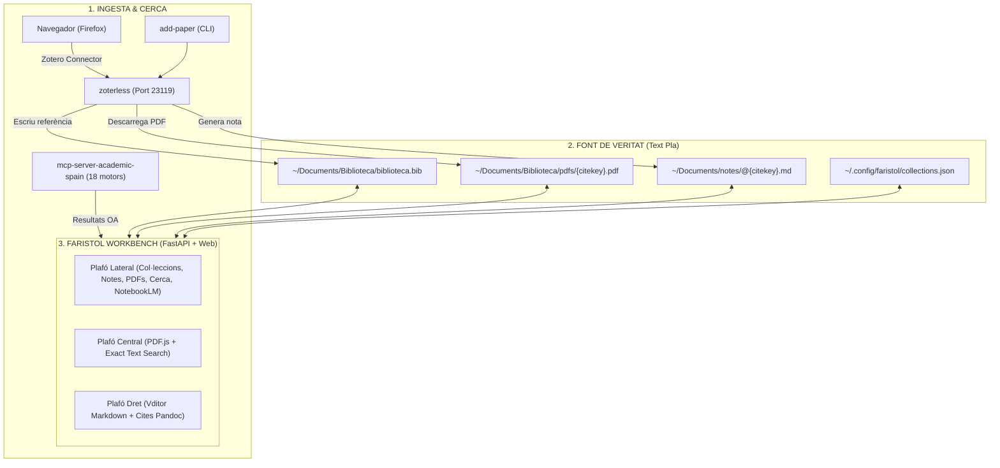

# 📖 Faristol

> **Banc de treball lliure per a la lectura de PDFs, anotació i síntesi bibliogràfica.**  
> *Inspirat en Org-Noter, Zotero, Better BibTeX, Better Notes i ZotMoov.*  
> *Zero bases de dades opaques, 100% fitxers plans (Markdown + BibTeX + PDFs).*

---

## 🧭 Què és Faristol?

**Faristol** és una estació de treball acadèmica i entorn de lectura (*reading workbench*) dissenyada per a investigadors, docents i estudiants que volen llegir documents en PDF, prendre notes estructurades i sintetitzar coneixement sense dependre de formats propietaris ni bases de dades tancades (com SQLite o núvols privatius).

El nom prové del mot genuí **faristol** (*el moble o suport inclinat on es col·loca el llibre obert per poder llegir còmodament i prendre notes alhora sense haver d'aguantar-lo amb les mans*): el nostre faristol digital sosté el document PDF davant dels teus ulls mentre prens notes i reflexiones lliurement en el teu quadern de recerca.

Faristol presenta una interfície web moderna de **tres plafons sincronitzats**:
1. **Plafó lateral de navegació i cerca:** Carpetes i col·leccions virtuals, explorador de notes, explorador de PDFs de la biblioteca, xat d'IA integrat amb NotebookLM i cerca acadèmica federada en 35 bases de dades i repositoris.
2. **Visor de PDF central (PDF.js personalitzat):** Renderitzat fluid, subratllat persistent, cerca exacta multilínia, navegació per pàgines i extracció automàtica d'anotacions.
3. **Editor de notes (Vditor Markdown):** Editor WYSIWYG/Markdown amb suport complet per a KaTeX (fórmules matemàtiques), etiquetes `#tags`, retroenllaços bidireccionals (*backlinks/outlinks*), citacions Pandoc `[@citekey, p. X]` i salts instantanis a la pàgina exacta del PDF.

---

## 💡 Inspiracions i Llinatge

Faristol no neix del no-res; sintetitza les millors idees del programari lliure acadèmic dels darrers vint anys en una arquitectura moderna basada en la web i en fitxers plans:

```
┌───────────────────────────────────────────────────────────────────────────┐
│                        INSPIRACIONS DE FARISTOL                           │
├───────────────────────────────────────────────────────────────────────────┤
│ 1. Org-Noter (Emacs)       │ Lectura sincronitzada PDF ↔ Notes a dos plafons│
│ 2. Zotero & Connector      │ Captura d'articles al navegador en 1 clic    │
│ 3. Better BibTeX (BBT)     │ Citekeys canòniques 'autorTitolAny' i .bib   │
│ 4. Better Notes            │ Notes Markdown dedicades per a cada referència│
│ 5. ZotMoov / ZotFile       │ Gestió i reanomenat de PDFs en carpetes netes │
└───────────────────────────────────────────────────────────────────────────┘
```

1. **Org-Noter (Emacs):**  
   El paquet llegendari d'Emacs que va inventar la lectura sincronitzada entre un document (PDF/EPUB) i un document de notes, permetent saltar entre el text de la nota i la ubicació exacta del PDF. Faristol modernitza aquesta experiència per a la web amb Markdown estàndard, citacions Pandoc (`[@citekey, p. 12]`) i concordança exacta de text multilínia.
2. **Zotero & Zotero Connector:**  
   Aprofitem el connector oficial de Zotero per a Firefox i Chrome gràcies a l'emulació de [zoterless](https://github.com/CasimirVictoria/zoterless), que respon al port local `23119` sense necessitat de tindre Zotero Desktop obert.
3. **Better BibTeX (BBT):**  
   Totes les publicacions tenen una clau de citació canònica i unívoca (`pont-niclosCreativityArtificialIntelligence2024`), i el fitxer `biblioteca.bib` és la font de veritat bibliogràfica del sistema.
4. **Better Notes:**  
   Cada document té la seua pròpia nota associada en Markdown (`@{citekey}.md`) amb metadades YAML (títol, autors, data, tags, enllaç al PDF) i espai per a resums, cites literals i reflexions personals.
5. **ZotMoov / ZotFile:**  
   Els PDFs no queden atrapats en directoris críptics ni en registres SQLite: es desen amb el seu nom canònic `{citekey}.pdf` a la carpeta oberta `~/Documents/Biblioteca/pdfs/`.

---

## 🏛️ L'Ecosistema: Faristol + zoterless + academic-spain

Faristol és la cara visual d'un ecosistema modular basat en la filosofia UNIX (*cada eina fa una cosa i la fa bé*):



### Divisió de responsabilitats:
- **`zoterless`:** El dimoni de captura en segon pla. Rep les crides del Zotero Connector, cerca el PDF en accés obert (Unpaywall multi-ubicació, OpenAlex, repositoris OJS/DSpace), genera la citekey BBT, actualitza `biblioteca.bib` i crea la nota `@citekey.md`.
- **`mcp-server-academic-spain`:** El motor de cerca acadèmica federada. Realitza consultes en paral·lel a 35 plataformes i repositoris (Dialnet, OpenAlex, ERIC, CSIC, arXiv, PubMed, SciELO, DOAJ, DBLP, Recolecta, TDR, etc.) amb suport per a EduVPN.
- **`Faristol`:** El banc de treball unificat on llegeixes el PDF, prens notes al costat, consultes la IA de Google NotebookLM sobre els teus documents i gestiones les teues col·leccions virtuals.

### 🔄 El Cicle Virtuós de Millora Compartida (Font Única)
Faristol aprofita la intel·ligència centralitzada de `mcp-server-academic-spain`:
- Quan es descobreix un nou repositori o es corregeix un repte antibot d'una editorial científica (com el cas d'Springer o la resolució exacta per DOI a OpenAlex), **Faristol obté la millora automàticament**.
- El mateix codi que empren els agents d'IA (Antigravity/Claude) i la consola (`add-paper`) és el que alimenta la pestanya de cerca de Faristol: una millora al motor beneficia simultàniament la IA, el terminal i el teu banc de lectura.

---

## ✨ Característiques Principals

### 1. Lectura a dos plafons estil Org-Noter
- Obre simultàniament el document PDF i la seua nota d'estudi.
- Fes clic a qualsevol citació tipus `[@citekey, p. 15]` o referència de pàgina a la nota per **saltar automàticament a la pàgina exacta del PDF**.
- Subratlla text al PDF i copia'l com a cita textual formatejada directament a la nota amb un sol clic.

### 2. Visor PDF.js d'alta precisió
- Cerca de text multilínia millorada: troba frases que creuen salts de línia o guionets de paraula.
- Subratllats persistents desats a disc (`~/.config/faristol/highlights.json`).
- Extracció d'anotacions natives i subratllats existents amb PyMuPDF (`fitz`).

### 3. Editor Markdown ric (Vditor)
- Format en temps real, mode pantalla dividida o mode codi font pur.
- Renderitzat matemàtic complet amb KaTeX (`$E = mc^2$`).
- Suport per a etiquetes YAML (`tags: [lectura, ia, didactica]`) i `#etiquetes` al text.
- Gràfic de retroenllaços (*backlinks*) i enllaços sortints (*outlinks*) per a navegació en xarxa tipus Zettelkasten / Obsidian.

### 4. Cerca Acadèmica Federada Integrada
- Pestanya **[ 🌐 Cerca ]** al plafó lateral.
- Cerca instantània a través de 35 cercadors acadèmics i repositoris.
- Traducció automàtica local de consultes (català ↔ anglès / castellà) mitjançant Argos Translate.
- **Importació en 1 clic:** descarrega el PDF en accés obert, l'incorpora a la biblioteca i crea la nota Markdown automàticament.

### 5. Xat d'IA amb Google NotebookLM (RAG)
- Connecta les teues col·leccions de documents directament amb NotebookLM mitjançant el CLI oficial `nlm`.
- Fes preguntes complexes sobre el conjunt de documents de la col·lecció.
- Les respostes inclouen citacions amb enllaços directes que obren el PDF corresponent a la pàgina de la font.
- Injecta la síntesi de la IA directament a la teua nota amb el botó "Injectar a la nota" o exporta en Markdown pur amb cites acadèmiques.

### 6. Col·leccions Virtuals
- Organitza la teua biblioteca en carpetes temàtiques i subcarpetes jeràrquiques sense moure els fitxers de disc.
- Assigna notes i PDFs a múltiples col·leccions alhora.
- Sincronització directa de la col·lecció amb un quadern de NotebookLM.

---

## 📁 Estructura de Fitxers Canònica

Faristol opera exclusivament sobre la teua estructura de documents estàndard:

```text
~/Documents/
├── Biblioteca/
│   ├── biblioteca.bib          # Base de dades BibTeX canònica
│   └── pdfs/                   # PDFs organitzats per citekey
│       ├── berzosaPensamentComputacional2024.pdf
│       └── turingComputingMachinery1950.pdf
└── notes/                      # Notes en Markdown / Denote
    ├── @berzosaPensamentComputacional2024.md
    ├── @turingComputingMachinery1950.md
    └── 20260920T120000--didactica-de-la-fisica_ciencies.md
```

Configuració i metadades auxiliars:
```text
~/.config/faristol/
├── collections.json            # Arbre de col·leccions virtuals
└── highlights.json             # Subratllats de lectura persistents
```

### 🏷️ La Convenció de l'Arroba (`@`): Notes Bibliogràfiques vs. Notes Pròpies

Al directori `~/Documents/notes/`, Faristol i el seu ecosistema distingeixen de forma fonamental dues tipologies de notes mitjançant el prefix del fitxer:

| Tipus de Nota | Nomenclatura del fitxer | Descripció i Propòsit | Exemple |
| :--- | :--- | :--- | :--- |
| **Nota Bibliogràfica** *(Literature Note)* | **`@{citekey}.md`** *(sempre amb arroba inicial)* | Fitxa d'estudi vinculada directament a una font externa, document o article científic. Conté les metadades YAML (`citekey`, `pdf`), resums de l'obra, cites textuals i reflexions sobre la lectura. | `@berzosaPensamentComputacional2024.md` |
| **Nota Pròpia / Permanent** *(Evergreen / Atomic Note)* | **`{timestamp}--{slug}_{tags}.md`** o **`{slug}.md`** *(sense arroba)* | Nota de pensament propi elaborada totalment per nosaltres. Desenvolupa un concepte, tesi, hipòtesi o argument personal (seguint Denote o Zettelkasten). Enllaça cap a les fonts usant `[[@citekey]]` o cites Pandoc `[@citekey, p. 12]`. | `20260920T120000--didactica-de-la-fisica_ciencies.md` |

> **Per què aquesta distinció és crucial?**  
> 1. **Diferenciació visual i conceptual immediata:** Amb un cop d'ull a la carpeta de notes o a l'arbre lateral de Faristol, saps a l'instant si estàs llegint la síntesi d'un autor extern (`@...`) o una idea original teua.  
> 2. **Vinculació automàtica 1:1:** Faristol i `zoterless` aprofiten el patró `@{citekey}.md` per obrir automàticament el PDF corresponent `{citekey}.pdf` al visor central i resoldre les metadades de `biblioteca.bib`.  
> 3. **Claredat epistèmica en la investigació:** Evita la confusió freqüent en el treball acadèmic entre el que diu la literatura científica i el que constitueix la teua pròpia aportació o anàlisi.

---

## 🚀 Instal·lació i Ús

### Requisits
- Python 3.10 o superior.
- Navegador web modern (Firefox, Chromium, Brave).
- Opcional: `okular` (visor natiu KDE), `kate` (editor natiu KDE), `nlm` (NotebookLM CLI).

### Instal·lació ràpida

```bash
# 1. Clonar el repositori
git clone https://github.com/CasimirVictoria/faristol.git ~/Projects/faristol
cd ~/Projects/faristol

# 2. Instal·lar dependències
pip install -r requirements.txt

# 3. Enllaçar l'executable al teu PATH
ln -sf ~/Projects/faristol/bin/faristol ~/.local/bin/faristol
```

### Execució

```bash
# Iniciar Faristol i obrir el navegador automàticament (port 8080)
faristol

# Obrir un PDF directament a Faristol
faristol paper.pdf
faristol ~/Documents/Biblioteca/pdfs/berzosaPensamentComputacional2024.pdf

# Obrir una nota directament a Faristol
faristol @berzosaPensamentComputacional2024.md

# Especificar un port alternatiu
faristol --port 8090

# Executar en mode servidor sense obrir el navegador
faristol --no-browser
```

---

## ⌨️ Dreceres de Teclat a Faristol

| Drecera | Acció |
| :--- | :--- |
| `Alt + 1` | Activa el Plafó Lateral |
| `Alt + 2` | Activa el Visor de PDF |
| `Alt + 3` | Activa l'Editor de Notes |
| `Ctrl + S` | Desa la nota activa |
| `Ctrl + F` | Cerca al document o a la llista de notes |
| `Ctrl + Enter` | Executa la cerca acadèmica / Envia consulta a NotebookLM |

---

## 📄 Llicència

Distribuït sota la llicència [MIT](LICENSE).  
Desenvolupat amb passió pel programari lliure, el text pla i la sobirania digital.
